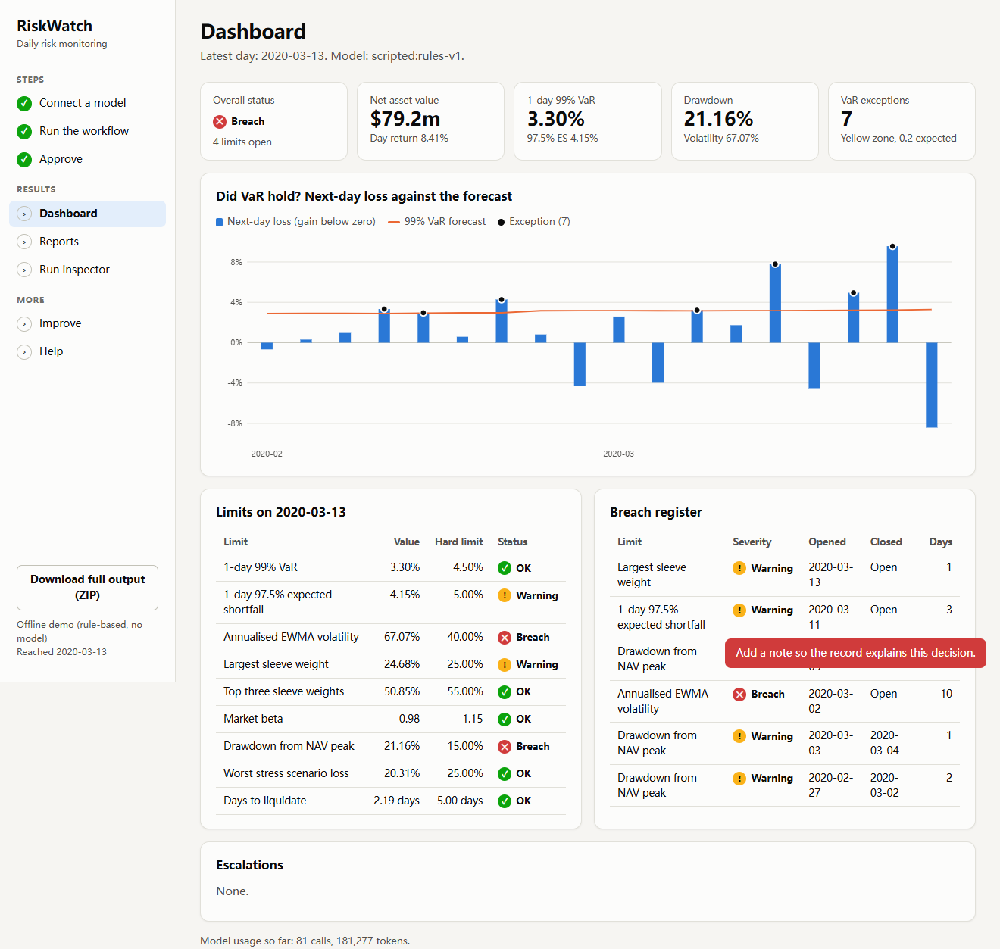

# RiskWatch: a long-running agent workflow for daily portfolio risk monitoring

**Author:** Pablo Carpanetti, student ID 25210660154
**Course:** AI Coding in Finance, Fall 2026, final project
**Repository URL:** not applicable. This project is submitted as a local Git repository, and all files and history
are in this ZIP.

## What this is

Every trading day a risk team must measure portfolio risk, test limits, explain what moved, check that the data can be
trusted, and get a signed-off report to the Chief Risk Officer. RiskWatch runs that process end to end as a persistent
workflow. Deterministic code computes every number. LLM agents triage data, explain moves, write the memo and review
it. A controller owns scheduling, checkpoints, retries, budgets, approvals and escalation. It remembers open breaches
across days, scores its own VaR forecasts, restates when vendors correct data, resumes after a crash without repeating
work, and accepts changes to itself only through a fixed baseline test.

The replay uses **real market data** from the 2020 crash (Ken French daily industry returns) on a **fictional book**,
with vendor faults injected to give labelled ground truth.

## Run it in your browser

**Windows:** double-click `start.bat`. **Mac or Linux:** run `sh start.sh`. Your browser opens at
`http://127.0.0.1:8765/`, and the app walks you through everything:

1. **Connect a model:** your name, then Claude login, an API key and address for any provider, or the offline demo.
2. **Run the workflow:** choose a period and who approves, and watch it progress.
3. **Approve:** read each flagged memo, then approve, reject or request changes.
4. **Results:** dashboard, reports, a run inspector, and a one-click ZIP of the full output.

[GETTING_STARTED.md](GETTING_STARTED.md) is the plain-language guide. The only requirement is Python 3.10 or newer.



## Start here

| To see | Open |
|---|---|
| How to use the app, step by step | [GETTING_STARTED.md](GETTING_STARTED.md) |
| The task, stages, triggers, cutoffs, acceptance criteria | [docs/task_specification.md](docs/task_specification.md) |
| The architecture and design decisions | [docs/design_note.md](docs/design_note.md) |
| The annotated diagram | [docs/workflow_diagram.png](docs/workflow_diagram.png) |
| What was measured | [evidence/README.md](evidence/README.md) |
| Sample outputs | [examples/README.md](examples/README.md) |

## Guide to the files

| Path | Contents |
|---|---|
| `docs/` | Task specification, design note, workflow diagram, VaR backtest chart |
| `prompts/` | System prompt for each of the five agent roles |
| `skills/` | Reusable instructions each role loads (`SKILL.md` format) |
| `config/` | `workflows.yaml` (DAGs), `agents.yaml` (permissions, schemas), `policy.yaml` (limits, retries, gates), `limits.yaml`, `risk_model.yaml` |
| `start.bat`, `start.sh`, `launch.py` | One-step start: installs what is missing and opens the browser app |
| `src/riskwatch/` | `controller.py`, `scheduler.py`, `state.py`, `pit.py`, plus `risk/`, `stages/`, `agents/`, `llm/`, `verify/`, `improve/`, `web/` |
| `data/` | Public return data, the generated bitemporal feed and the fault labels; see [data/README.md](data/README.md) |
| `scenarios/replay.yaml` | The fixed replay: simulated approvals and injected agent and provider faults |
| `eval/` | Pre-registered rules (`policy.yaml`), candidates, frozen baselines and results |
| `versions/` | Frozen bundles, the `ACTIVE` pointer and the append-only `registry.jsonl` |
| `tests/` | The test suite, including a crash test at each of 58 named points |
| `evidence/` | Test results, recovery, leakage, evaluation, versioning and replay records |
| `examples/` | Curated artifacts from the replay, such as memos, failed drafts and restatements |
| `scripts/` | Feed builder, figures, recovery and version demos, evidence export, ZIP packaging |

## Terminal setup

Everything the browser app does is also available from the terminal. You don't need this section to use the app.

Requires Python 3.10 or newer. No API key is needed for anything below except the optional live run.
On Windows, unpack to a short path such as `C:\rw`, because very long paths hit the 260-character limit.

```bash
python -m venv .venv
source .venv/bin/activate          # Windows: .venv\Scripts\activate
pip install -e ".[dev]"
python -m pytest -q                # about 2 minutes
```

Dependencies are numpy, pandas and PyYAML, plus pytest and matplotlib for development. Model access and the web app need
no extra packages. Tested on Windows 11 with Python 3.14 and 3.15.

## Terminal walkthrough

Commands use the `riskwatch` entry point, and `python -m riskwatch` is equivalent. State goes in `runtime/`, or wherever
`RISKWATCH_HOME` points.

**1. Replay the start of the crash** (about a minute, offline):

```bash
riskwatch replay --start 2020-02-18 --end 2020-03-13
riskwatch status
riskwatch status eod-2020-03-09      # one run, stage by stage
```

Memos land in `runtime/published/memos/`. The full fixed year is `riskwatch replay` with no dates, which takes about
10 minutes.

**2. Act as the approver.** Start fresh and drive one day by hand:

```bash
export RISKWATCH_HOME=runtime/manual           # PowerShell: $env:RISKWATCH_HOME="runtime/manual"
riskwatch init --start 2020-03-16
riskwatch tick --now 2020-03-16T20:00          # stops at the human gate
riskwatch pending
riskwatch request-changes eod-2020-03-16 --by "your name" --note "Lead with the largest risk driver"
riskwatch approve eod-2020-03-16 --by "your name"
```

**3. Crash it and resume.** Kill the process mid-stage, then re-run:

```bash
export RISKWATCH_HOME=runtime/crash
riskwatch init --start 2020-03-16
RISKWATCH_CRASH_AT=writer:llm_journaled riskwatch tick --now 2020-03-16T20:00   # dies, exit code 137
riskwatch status eod-2020-03-16                # writer shows as still running
riskwatch tick --now 2020-03-16T20:00 --takeover
```

In PowerShell, set `$env:RISKWATCH_CRASH_AT="writer:llm_journaled"` first, and remove it before resuming. The finished
LLM calls are replayed from the journal, not repeated. `python scripts/demo_recovery.py` does the harder version, killing the
process from outside at random moments and comparing everything with a clean run.

**4. Test a change against the baseline** (about 5 minutes each):

```bash
riskwatch eval --candidate eval/candidates/loose_outlier_filter.yaml
riskwatch versions list
```

The Git-tracked `versions/registry.jsonl` gets a new entry from this. Set `RISKWATCH_VERSIONS` to a copy if you want to
leave it untouched.

## Using your own model and provider

The browser app's Connect step does all of this for you. In the terminal, the default backend, `scripted`, is rule-based
code rather than a model, and it keeps everything runnable offline. To use a real model, copy `.env.example` to `.env`,
or set these variables:

```bash
LLM_PROVIDER=openrouter     # or claude-code, openai, anthropic, kimi, deepseek, qwen, mistral, groq, ollama, custom
LLM_MODEL=<any model id your provider offers>
LLM_API_KEY=<your key>
```

Then check the connection and run a short window:

```bash
riskwatch provider-check
RISKWATCH_HOME=runtime/live riskwatch replay --start 2020-03-09 --end 2020-03-11
```

- `LLM_PROVIDER=claude-code` needs no key. It uses the Claude Code account signed in on this computer, with every tool
  disabled, so agents stay pure text functions.
- Any OpenAI-compatible endpoint works through `LLM_PROVIDER=custom` with `LLM_BASE_URL`.
- `LLM_PROVIDER_REVIEWER`, `LLM_MODEL_REVIEWER` and `LLM_API_KEY_REVIEWER` put one role on a different vendor. That
  also applies to the other roles, for example `LLM_MODEL_MEMO_WRITER`.
- Set `LLM_PRICE_IN_PER_MTOK` and `LLM_PRICE_OUT_PER_MTOK` so the dollar limit can work. Otherwise the call and token
  limits still apply.
- The scripted faults in `scenarios/replay.yaml` do not apply to a real provider. Agent and provider failures are then real ones.

Keys are read from the environment or `.env`, which is Git-ignored, and are never written to state or artifacts.

## Honest limits of this submission

See the end of [evidence/README.md](evidence/README.md) for what was and was not tested. In short: all recorded evidence
comes from the scripted backend, so it demonstrates the harness and not the quality of any LLM.

## My contribution

I chose portfolio risk monitoring as the task, set the scope (a working harness with real recovery and evaluation
evidence, not a design alone), and required that the system work with any model or provider so that a reader can run it
with their own key.

I built the project with Claude Code (Anthropic's coding agent), which wrote the code, tests and first drafts of the
documents under my direction. Its commit history shows that work as it happened, including the defects the replay
exposed and how they were fixed.
