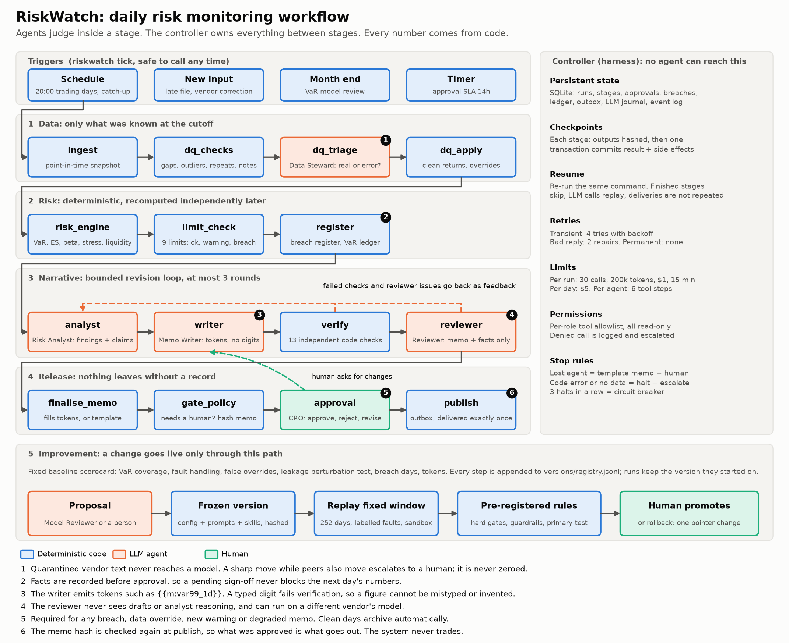
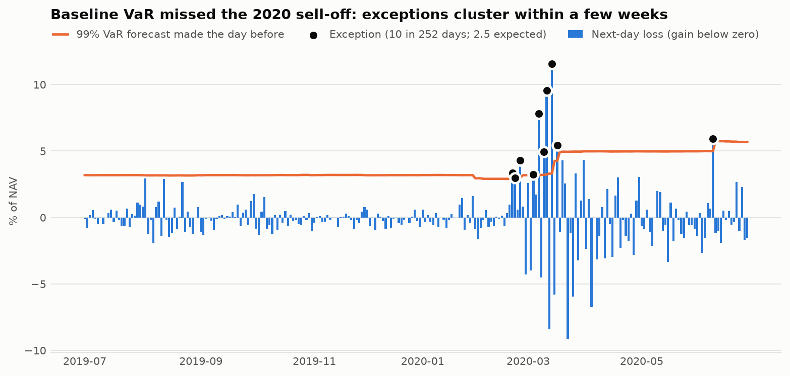

# Design note: RiskWatch

RiskWatch runs a daily portfolio risk process from data arrival to signed-off memo, and it keeps running: it
tracks breaches across days, scores its own VaR forecasts, restates when vendors correct data, and tests changes
to itself against a fixed baseline. The task itself is specified in [task_specification.md](task_specification.md).

The governing idea is a strict split. **Code owns every number and every execution decision. Agents own judgement
calls, and only inside a stage.** Agents can read, but they cannot act: no role holds a tool that writes anything.

## 1. Roles and handoffs

| Role | Responsibility | Tools (all read-only) | Skill | Reads | Writes |
|---|---|---|---|---|---|
| Data Steward | Is a flagged record a real move or a vendor error? | `get_asset_history`, `get_cross_section` | `dq-triage` | `dq_report.json` | `dq_decisions.json` |
| Risk Analyst | What changed and why, as checkable claims | `get_metric`, `get_asset_history`, `get_breach_history`, `get_backtest` | `breach-analysis` | Metrics, limits, breach delta | `analysis.r{n}.json` |
| Memo Writer | Turn findings into a memo, using tokens for figures | `get_metric` | `memo-style` | Limits, findings, DQ items, feedback | `memo_draft.r{n}.md` |
| Reviewer | Could a reader be misled or unable to act? | None | `memo-review` | Finished memo and source facts only | `review.r{n}.json` |
| Model Reviewer | Monthly: is the VaR model adequate? | `get_backtest` | `model-review` | Backtest statistics | `model_review_agent.json` |

Handoffs are files with a schema. Each agent's output is validated by the harness before the next stage can start,
so a stage depends on an artifact and never on another agent's conversation. Prompts are in `prompts/`, skills in
`skills/`, and permissions and output schemas in `config/agents.yaml`.

**Why the work is divided this way.** Each split removes a specific failure:

- *Analyst and writer* are separate so that claims become structured data a checker can test before they turn into prose.
- *Writer and reviewer* are separate because a reviewer that shares the writer's context tends to share its mistakes.
  The reviewer sees no drafts or reasoning, and `LLM_PROVIDER_REVIEWER` can put it on another vendor's model.
- *Data Steward* is separate because a data judgement must be finished and recorded before any risk number exists.
  Mixing it with analysis would let the desired story influence the data.

**Deterministic code does all calculation:** VaR, ES, volatility, betas, stress, liquidity, attribution of VaR changes,
limit tests, breach lifecycle and backtests. The writer cannot type a figure. It emits tokens such as `{{m:var99_1d}}`,
the harness fills them in, and any digit outside a token fails verification.

**Agent decisions versus execution control:**

| Agents decide | The controller decides |
|---|---|
| Accept, zero or escalate a flagged record | Which stage runs next, and whether to skip it |
| What explains a move | How many retries; when to stop |
| How to word the memo | Whether a memo may proceed; whether a human is needed |
| Whether a memo could mislead | Whether a run has exhausted its budget or its revision rounds |
| Whether the VaR model looks adequate | Which version is live, and whether anything is published |

Even inside agent decisions the harness keeps the last word. A quarantined note is forced to `escalate` whatever the
agent says, and a missing row can only be filled by rule.

**Any provider.** All model access goes through `src/riskwatch/llm/providers.py`, with no vendor SDK. Two HTTP protocols
cover OpenAI-compatible vendors and Anthropic. A third route calls the local Claude Code CLI, so a signed-in Claude account
works without a key, with every tool, MCP server, skill and user setting disabled so the agent stays a pure text function.
Tool calling uses plain JSON in the text channel rather than a vendor function-calling API, so any chat model can drive the loop.

**The browser app is a front door, not a second system.** `start.bat` opens a local page that collects the user's name
and model settings, starts runs, takes approvals and offers the full output. Runs are ordinary `riskwatch` processes, and
decisions go through the same controller, queued behind the same lease. It holds keys, so it listens on 127.0.0.1 only,
checks the Host header, needs a session token on every POST, and renders agent text as text, never as HTML.

## 2. Long-running operation

**Persistent state.** One SQLite file holds runs, stage status, approvals, the breach register, the VaR ledger, DQ
overrides, the outbox, the LLM journal, escalations and an append-only event log. Artifacts live in a folder per run.
Nothing that matters is held in memory between stages.

**Checkpoints.** Artifacts are written to a temporary file and renamed, so a crash cannot leave half a file. A stage
then commits its output hashes and any state changes in one transaction. A stage is either fully done or not done.

**Dependencies.** Each workflow is a DAG in `config/workflows.yaml`, validated at load time. Across days, a run's
`register` stage waits for the previous day's `register`, because breach lifecycles are ordered. The register is
updated *before* the approval gate: it records facts, so an unanswered approval never stops the next day's numbers.

**Triggers.** `riskwatch tick` is the single entry point, called by cron every 30 minutes in production and by a
simulated clock in replay. It creates what is due, including runs missed during downtime, each with its original cutoff.
It also detects vendor corrections, reopens blocked runs and checks approval SLAs. Calling it twice is harmless.
It resumes from the last day it scheduled, so a workspace spanning decades costs the same per tick as a fresh one.

**Any period, fixed test window.** Runs may cover any trading day from 1986 to September 2026. Each run keeps only
the history its version's risk model reads (501 days for the baseline), so its inputs stay small. The fund launches
with $100m the day before a workspace's first day. The evaluation window, its faults and the frozen baseline did not
move: the feed was extended around a book anchored on the eve of that window, and the baseline replays identically.

**Resuming without repeating work.** Recovery is the same command again. Then:

| Completed action | How repetition is prevented |
|---|---|
| Finished stage | Skipped, after its output hashes are re-verified. A corrupt artifact triggers a rebuild, or a halt if a side effect lies downstream |
| LLM call | Looked up in the journal by run, stage, round and request hash, then replayed at no cost |
| Register and ledger update | Commits atomically with the stage checkpoint, so it happened once or not at all |
| Delivery | Outbox row plus a receiver that ignores repeats |
| Run creation | Primary key on the run id |

One gap is unavoidable: if a process dies after a provider answers but before the journal commit, that single call is
repeated on resume. A lease stops two controllers working at once, and `--takeover` claims it after a crash.

**Retries and stop rules:**

| Situation | Response | If that fails |
|---|---|---|
| Rate limit, 5xx, dropped connection | 4 attempts, exponential backoff with jitter, honours `Retry-After` | Stage failure rules below |
| Malformed or invalid agent reply | 2 repair prompts stating the error | Stage failure rules below |
| Bad key, unknown model | No retry | Stage failure rules below |
| Agent stage fails, or budget runs out | **Degrade:** template memo with all numbers and no narrative, forced human approval, escalation | |
| Reviewer still unconvinced after 3 rounds | The memo that passed every check goes to the approver with the open concerns attached | |
| Checks still failing after 3 rounds | Template memo, forced human approval, escalation | |
| Data late or positions do not reconcile | Block; retry each tick, logging any cutoff extension | Halt at 23:30, critical escalation |
| Code exception | No retry, because code errors do not heal | Halt, escalate; a human runs `resume` after fixing it |
| Corrupt artifact upstream of a side effect | Halt rather than redo the side effect | Human |
| Agent requests a forbidden tool | Denied, logged, escalated | |
| Approval unanswered for 14 hours | Route to backup approver | |
| Three halted runs in a row | Circuit breaker stops new runs until a human resets it | |

The principle is that losing the agents must never mean losing the numbers. On the worst day, the provider being down
should not stop a risk report.

**Limits** (`config/policy.yaml`). Per run: 30 LLM calls, 200,000 tokens, $1 and 15 minutes. Per day: $5. Per agent
stage: 6 tool steps. HTTP calls time out after 120 seconds. Tool permissions are an allowlist per role. Agents have no
filesystem, network or shell access, and their tools read only that run's frozen artifacts.

## 3. Verification and improvement

**Checks independent of the producer.** `verify` runs 13 checks in code. The main ones:

- A second implementation of the headline metrics, in plain Python with no shared code, must agree within 1e-9.
- Limits are re-evaluated from scratch, and input timestamps are audited against the cutoff.
- Every token resolves and no digit is typed by hand.
- Every active limit, finding and DQ item is tagged in the memo.
- Each analyst claim is tested against the data, for example "VaR rose".
- No trade instructions, no injected text, and no knowledge of later events.

The Reviewer then covers what code cannot: whether the wording could mislead. A reviewer pass cannot override a failed check.

**Human approval.** A person must decide before release if there is a hard breach, a new warning, a data override or
escalation, a degraded memo, a material restatement or a model review. Clean days archive automatically. The approver
can approve, reject, or request changes, which sends their note back through the revision loop. The approved memo's
hash is checked again at publish. The system never trades: it reports, and the portfolio manager acts.

**Bounded revision.** At most three rounds of analyst, writer, verify and reviewer. Only the role that can fix a fault
is re-run with feedback. When rounds run out, the run degrades as above, so the loop always ends.

**Testing a change against a fixed baseline.**

1. A change is an overlay in `eval/candidates/`. A version is the hash of all config, prompts and skills together, so
   a one-word prompt edit is a new version.
2. `riskwatch eval` replays a fixed 253-day window in a sandbox, with labelled vendor faults and the same failure
   scenario, and produces a scorecard.
3. `eval/policy.yaml` decides. Hard gates: every labelled fault handled, no new false overrides, no halted runs, no
   leakage. Guardrails: average VaR, breach days and token use may not rise beyond set bounds. Primary test: VaR
   coverage must improve. These rules were committed before any candidate ran, and Git history shows that order.
4. The result is appended to `versions/registry.jsonl`, which records every registration, evaluation, promotion and rollback.
5. Promotion needs a person, and the code refuses it without an accepted evaluation against the *currently active* version.
6. Rollback moves one pointer back. Runs load frozen snapshots rather than the working tree, so the old behaviour
   returns exactly, and a run in flight finishes on the version it started with.

**Preventing future-information leakage.** Time-sensitive leaks come from three directions, and each has its own defence:

| Leak path | Defence |
|---|---|
| **Data.** Reading rows not yet published | Every row is bitemporal, and all reads go through one point-in-time store that takes a cutoff. A test confirms nothing else opens the feed. Corrections never rewrite an issued report |
| **Evaluation.** Scoring on information from the future | VaR made at T is scored only in the T+1 run. Fault labels are read only by the evaluator, and a test enforces that |
| **Model memory.** An LLM knows what happened in March 2020 | Calendar dates are hidden from every agent (a test scans all requests), prompts forbid using remembered events, and replay rejects memos with terms such as "covid" that no input contains |

The check is a **future-perturbation test**: corrupt everything published after the cutoff, re-run, and require every
artifact to stay byte-identical. A negative control disables the cutoff filter and confirms the test then fails, so
the test is known to be able to catch a leak.

## 4. What repeated evaluation found

The first full replay passed its tests and still exposed design errors that no single-day run had shown, and the first
real model exposed more that no rule-based stand-in could. Each became a regression test, and the commits record the fixes.

| Found by | Defect | Fix | Commit |
|---|---|---|---|
| Full replay | The steward zeroed the real -19.7% energy move of 2020-03-09 as a bad tick, hiding a genuine loss | Sharp moves while peers also move now escalate to a human | `bb309a3` |
| Full replay | Stale values passed as "plausible", but a resent value is always plausible | Unexplained repeats escalate | `bb309a3` |
| Full replay | The LLM journal replayed a round's verdict into the next round, so the loop could not finish | Round is part of the journal key | `873da3a` |
| Leakage test | The reviewer saw the calendar date in the memo title | Dates are masked in every agent request | `bb309a3`, test in `873da3a` |
| Reading the report | The hard-kill report claimed four kills when two came after the process had exited | Only kills that land on a running process count | `5edfc4d` |
| First real model | A memo passing all 13 checks was thrown away for a template because the reviewer stayed unconvinced | Verified memos go to the approver with open concerns attached | See `git log` |
| First real model | The reviewer rejected true statements as unsupported, because it could not see the metrics they cited | It now receives the metrics, what is new, and prior values | See `git log` |
| First real model | "3.0 days against a warning of 3.0 days" hid a value of 3.04 | Two decimals | See `git log` |
| Clean-install test | First launch failed on Python 3.15 without a C compiler, because PyYAML had no prebuilt package | The launcher installs the pure-Python build | See `git log` |

Against the baseline, three of four candidates were rejected under the rules fixed beforehand, including a real coverage
improvement that breached the VaR guardrail. The accepted candidate is **not** live, for reasons set out in
[evidence/README.md](../evidence/README.md), which also lists what was not tested.

On a real model (Claude Sonnet), the data steward made all six judgements correctly across two runs of the hardest days,
including escalating the energy collapse that the first rule-based steward had overwritten. After the fixes above, all four
days finished normally. This is a spot check, not a measurement: the recorded year and the evaluations use the stand-in.

